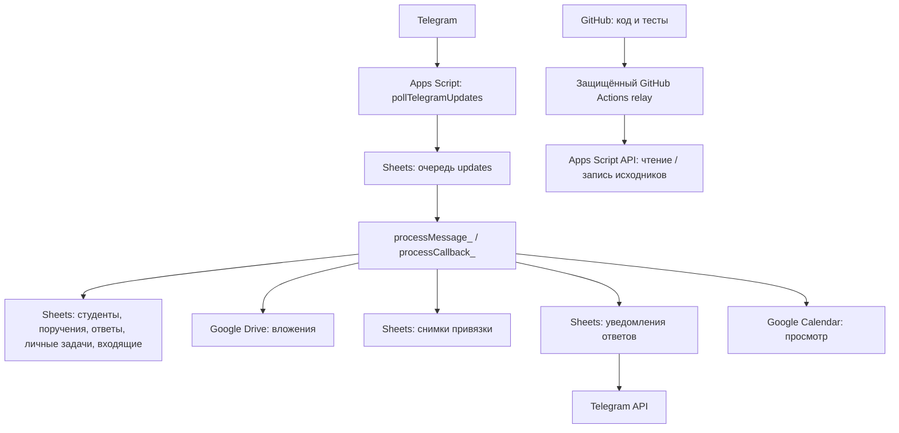
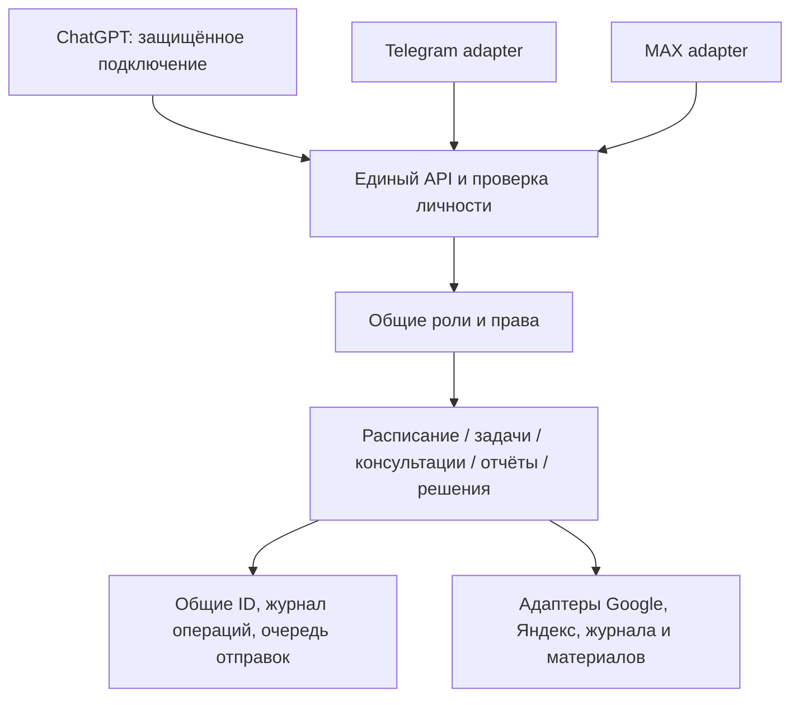

Последний локальный блок: [выбор текущей лекции кнопкой](LECTURE_MENU_ACCEPTANCE.md) — 842 Python +448 Node PASS; не включено в рабочем боте.

Последний локальный блок: [коды лекций и личная отметка посещаемости](LECTURE_ATTENDANCE_ACCEPTANCE.md) — 822 Python +448 Node PASS; не включено в рабочем боте.

Последний локальный блок: [восстановление очередей и сверка квитанций](RECOVERY_REVIEW_ACCEPTANCE.md) — 797 Python +448 Node PASS; не развёрнуто.

Последний локальный блок: [подтверждение кнопок Telegram](CALLBACK_ACK_ACCEPTANCE.md) — 773 Python +448 Node PASS; не включено в рабочем боте.

Последний локальный блок: [обновление материалов и история проверок](MATERIAL_UPDATE_ACCEPTANCE.md) — 747 Python +448 Node PASS, 11 offline демонстраций; не развёрнуто.

Актуальная локальная проверка: [готовность runtime](ACADEMIC_READINESS_ACCEPTANCE.md) и [условия подключения](ACADEMIC_CONNECTION_CHECKLIST.md). 731 Python +448 Node PASS; live не подтверждено.

Последний локальный блок: [академические ответы через очередь](ACADEMIC_DISPATCH_ACCEPTANCE.md) — 713 Python +448 Node PASS; не развёрнуто.

Последний локальный блок: [меню дисциплин и студентов](ACADEMIC_MENU_ACCEPTANCE.md) — 695 Python +448 Node PASS; не развёрнуто.

Актуальный локальный блок: [единая учебная сводка](ACADEMIC_OVERVIEW_ACCEPTANCE.md) — 673 Python +448 Node PASS, 10 offline демонстраций; не развёрнут.

Актуальное дополнение: [локальный journal-view](ACADEMIC_PROGRESS_ACCEPTANCE.md) — 20 новых тестов; не подключён к Telegram и реальному журналу.

# Единый помощник преподавателя — актуальная карта

**30 октября 2026 года.** Эта сводка заменяет исторические промежуточные статусы для понимания текущего состояния. Составлена по коду, отчётам установок и пользовательским журналам. Новых интеграционных запусков при составлении не было. Секреты и персональные данные не включены.

## Следующий блок собран — task-workflow-1

Завершена локальная сквозная приёмка «поручение → ответ/файл → запись → уведомление»: 35 новых тестов, единый воспроизводимый кандидат и протокол ограниченного реального запуска. Включены локальные /add, команды доступа и диагностика. **Пакет ещё не установлен**; 1mainchange/7preserved, свежий Google-source сверён без записи. [Полный результат и следующие условия](TASK_WORKFLOW_ACCEPTANCE.md). Последний набор: 596 Python +426 Node, 7 offline демонстраций.

## Блок 2 собран — расписание и консультации

Существующие алгоритмы НВГУ соединены с проверкой полноты занятости и меню/резервом/решениями Apps Script в локальном стенде. 55 новых тестов; последний полный набор — 629 Python +448 Node, 9 демонстраций. **Ничего не включено для реальных студентов.** Новый guard отдельного локального2.0.5 требует доверенный runtime provider, которого пока нет. [Отчёт и условия реального подключения](SCHEDULE_CONSULTATION_ACCEPTANCE.md).

## Главный вывод

Сейчас существуют два контура: реальный старый Telegram-помощник в Google Apps Script, куда внесены проверенные узкие исправления, и более широкий кандидат учебного помощника в репозитории. Второй контур имеет локально проверенные модули, но не работает целиком как установленный сервис. Кандидат 2.0.5 не был целиком развёрнут.

## Где что находится

| Часть | Расположение | Состояние |
|---|---|---|
| Рабочий Apps Script | Проект «Телеграм-помощник Кулагиной», основной файл «Код» и 7 других файлов проекта | Исходники согласованных патчей установлены и независимо перечитаны; это не подтверждение версии deployment или всех live-сценариев |
| Расширенный Apps Script кандидат | src/telegram_assistant_v2_0_5_candidate.gs | Локальный, целиком не установлен |
| Архивы и предыдущие кандидаты | src/archive и src/telegram_assistant_v2_0_2_candidate.gs — 2_0_4 | Сохранены; не объединять с рабочим скриптом |
| Учебное ядро и интеграционные адаптеры | tools/*.py | Локальные модули и тестовые сценарии; часть HTTP-клиентов готова, но единого работающего backend нет |
| Рецепты небольших legacy-патчей | tools/clasp/*.cjs, patches/*.patch | Отдельные устанавливаемые изменения; статус каждого фиксируется отдельно |
| Проверки | tests/, tools/check-local.sh | Последний полный результат: 629 Python +448 Node успешно, 9 offline демонстраций |
| История и ограничения | docs/AUDIT_REPORT.md, docs/TEST_PLAN.md, CHANGELOG.md, AGENTS.md | Подробный журнал; старые разделы могут описывать уже пройденные этапы |

## Что находится в реальном Apps Script

Базовые функции присутствуют в коде: регистрация и одобрение студентов, поручения, выбор поручения и приём ответа/файла, личные задачи /add /plan /done, входящие, просмотр Calendar, сводки, отправка поручений и напоминания. Фактический запуск всех этих сценариев после последних изменений не проверялся.

Установлены и независимо проверены следующие исправления:

1. Точная проверка одобренного доступа: отрицательный статус не даёт прав по совпадению слова.
2. Истёкший Telegram callback не блокирует основную обработку.
3. Защита повторного сохранения файла и консервативное поведение при неизвестном исходе Drive.
4. Долговременная очередь updates с RETRY/DEAD и сохранённым исходным payload.
5. Восстановление полей поручения после частичного сохранения ответа.
6. Постоянные ID поручений вместо номеров строк; снимок привязки до загрузки файла.
7. Защита новых текстовых записей от интерпретации как формул в покрытых полях.
8. План и отдельные квитанции уведомлений о новых ответах: PREPARED/SENDING/API_CONFIRMED/UNKNOWN. Подтверждение API не означает доставку.

Владелец отдельно подтвердил технические схемы: «Очередь updates» — 6 колонок, «Снимки операций» — 3, «Уведомления ответов» — 6. Последние два листа созданы соответствующими setup-функциями по журналам владельца; queue при проверке уже существовала.

**Не установлены** два последних локальных исправления: идемпотентный /add и безопасные повторы /approve /revoke. Их код и тесты готовы; права студентов этими кандидатами не менялись.

После отзыва неопознанного разрешения «Untitled project» текущий runtime-доступ рабочего скрипта к Sheets неизвестен. Подготовлена read-only проверка заголовков, но она ещё не выполнялась в Google. Принадлежность отозванного разрешения по скриншотам точно не установлена.

## Текущая архитектура

Это схема установленного исходного кода, не доказательство активного poll/trigger. В коде setupAutomation предусмотрены минутный опрос, отправка поручений каждые 5 минут и ежедневные напоминания/сводки. Фактический список установленных триггеров и активная версия deployment не проверены. setupAutomation не запускался для диагностики. Наличие webhook не подтверждено; рабочая модель входа — polling.

Канал GitHub → Google — **канал разработки**. Он имеет ограниченные операции чтения/записи исходников, encrypted backup, обязательный environment approval и независимую сверку. Он не является API управления учебными данными и не исполняет произвольные Apps Script функции.

## Более широкий учебный помощник

| Направление | Что реализовано в коде | Что ещё не подключено / не подтверждено |
|---|---|---|
| НВГУ → Calendar | Python parser, выбор недели/дат, нормализация, план изменений, защита повторов, ограниченный create-only runner | Постоянная синхронизация не включена; нет подтверждения исполнения согласованных 18 реальных созданий |
| Консультации | Меню, свои заявки, правила, предварительный резерв и решение в кандидате 2.0.5; Python-модель подтверждения/Calendar/уведомлений с защитой повторов | Не включены для реальных студентов; полнота занятий не доказана, сквозной live-цикл не принят |
| Повторяющиеся поручения, рассылки, справка/пасхалки | Реализации в кандидате 2.0.5 | Целиком в рабочий legacy не перенесены, реальная приёмка не выполнена |
| Общий реестр задач | Связующие функции кандидата 2.0.5 | Не подключён как единый достоверный реестр всех учебных операций |
| Преподаватель / лектор / замещение | Python policy с подтверждёнными bindings, правами по дисциплине/группе, полным академическим чтением и правом замещения | Реальные личности и права не связаны с рабочим ботом; legacy всё ещё имеет одного owner |
| Посещаемость лекций | Локальные 90-секундные окна кодов, права лектора/замещающего, истечение, защита повторов, шифрование | Нет действующей студенческой формы/QR, получения кода в рабочем Telegram, записи реального посещения и утренней рассылки кодов |
| Учебный журнал XLSX | Read-only разбор структуры и данных; аудит присланной книги | Нет разрешённого автоматического writer, полной привязки реальных student_id к строкам и надёжного live-источника журнала |
| ДЗ и обновление материалов | Чтение DOCX, версии/хеши требований, защита от завершения проверки по устаревшему документу, структурный пилот PPTX, доказательства наблюдений | Нет полного содержательного автопроверяющего, автоматического зачёта/оценок или подключённого потока работ студентов |
| /progress и запросы преподавателя | Локальная policy self-only, подготовка отчётов, Telegram adapter/inbox/dispatch и восстановление квитанций | Не установлен live-handler; текущие локальные отчёты не равны полному табелю оценок/посещений |
| «Требует моего решения» /decisions | Локальная очередь консультаций, проверок работ и технических случаев, фильтры/страницы/проверки прав | Не подключена к реальным источникам и рабочему Telegram |
| Яндекс Диск | Было подтверждено чтение metadata API, доступность папки материалов; часть DOCX исследована | Рабочий журнал не найден в выполненном ограниченном сканировании; постоянный источник и запись не настроены |
| Почта | Требования и отдельные права/контракты доставки | Реальная Яндекс Почта и отправка на подтверждённый адрес не подключены |
| ChatGPT | Локальная read-policy и план защищённого подключения | Рабочего бизнес-API/подключения для запросов из ChatGPT нет |
| MAX | Пока нет адаптера или разрешённого канала в policy | Требуются проверка официальных условий Bot API, создание подключения, identity binding и тесты |

### Что уже проверено на настоящих сервисах

Подтверждены Telegram getMe и одно полученное владельцем тестовое сообщение; Calendar чтение/часовой пояс и создание-обновление-удаление одного временного TEST-события; указанные source-установки; технические схемы; отдельный тест сохранения буквального текста в Google Sheets; исторические проверки Яндекс Диска.

В последней сверке НВГУ/Calendar на 2–8 ноября совпали 11 занятий; на 9–22 ноября подготовлен план 18 добавлений, без изменений/удалений существующих событий. Это исторический snapshot, не гарантия состояния календаря сегодня. Разрешение на конкретные 18 добавлений было получено, но подтверждения их исполнения нет; технические данные перед импортом надо обновить.

Эти результаты не подтверждают целиком работоспособность расширенного помощника, полноту расписания, реальную регистрацию студентов на консультации или запись академических данных.

## Можно ли управлять из ChatGPT, Telegram и MAX

**Да, как целевую архитектуру: одно учебное ядро и три интерфейса.** Технические условия выдачи и использования MAX Bot API ещё нужно проверить по официальной документации и для аккаунта владельца; это не уже готовое подключение.

Созданная в Telegram консультация должна быть видна в других разрешённых интерфейсах как та же заявка. Решение в одном канале меняет общий статус, а не создаёт независимую копию. У каждого транспорта собственные event IDs, у операции — единый domain ID/intent. Простое совпадение текста не означает дубль: два одинаковых запроса могут быть разными намеренными действиями.

Нужно подтвердить связь ChatGPT/Telegram/MAX-аккаунтов с одной реальной личностью. Имена/username/пересланный текст этой связи не доказывают. Владелец получает согласованные права; лектор — своё расписание и студентов в своих grants, замещение — конкретные разрешённые занятия; студент — только свои данные. В текущем Python allowlist MAX отсутствует и должен оставаться запрещённым до появления проверенного адаптера.

Подключение ChatGPT к учебному API — отдельная настройка от этого чата разработки и GitHub relay. Даже готовый API сам по себе не предоставляет этому разговору доступ: нужно реально подключить поддерживаемый инструмент/App/OAuth и проверить scopes/identity. Сначала разумно открыть разрешённое чтение; действия с правами, календарём, уведомлениями и журналом вводить по отдельным контрактам, а не выдавать неограниченный доступ.

Новый постоянно работающий сервис нужен для многоканального транспорта/учебного ядра; он пока не размещён. Можно постепенно использовать существующие Python-модули и сохранять Apps Script для работающих функций. Полная перепись не требуется. Локальный SQLite уже используется; выбор хранилища и production-хостинга ещё не сделан. Доступ к Google/Яндексу остаётся через явные серверные адаптеры, секреты — вне чатов и репозитория.

## Порядок завершения

1. **Свести состояние в одну карту** — этот документ; дальнейшие статусы вести здесь, а подробную историю оставлять в аудите.
2. Когда владелец вернётся к компьютеру, проверить read-only доступ рабочего бота после OAuth revoke. Установки /add и access-command кандидатов рассматривать отдельно, не автоматически.
3. Принять один реальный пользовательский маршрут от начала до конца. Предлагаемый первый: поручение → ответ/файл → корректная запись → уведомление преподавателю, с ограниченным тестом и проверкой повторов. Не объявлять весь проект запущенным по source-установке.
4. Завершить свежую проверку НВГУ и разрешённый ограниченный импорт. Затем доказать полноту занятости и принять консультации. Согласованные правила: будни 09–18, обед 11:40–12:20, 20 минут, кабинет 317, минимум 30 минут на запись/отмену, личное подтверждение каждой встречи, предварительное событие сразу после заявки.
5. Подключить реальные identity/grants и read-only журнал. Запустить /progress и отчёт преподавателю сначала в Telegram; критерии материалов читать актуальные, оценки и посещение без отдельного разрешения не писать.
6. Разместить единое ядро/API рядом с существующим ботом и подключить ChatGPT; затем MAX как второй мессенджер. Не копировать бизнес-логику по трём ботам.
7. Отдельная приёмка отправки на подтверждённую почту, записи академического журнала, посещаемости и содержательной проверки ДЗ. Условия и готовность каждого блока фиксировать независимо.

Сейчас от владельца, который без компьютера, действий не требуется. Этот документ не даёт новых разрешений на внешние операции и не запускает сервисы.
