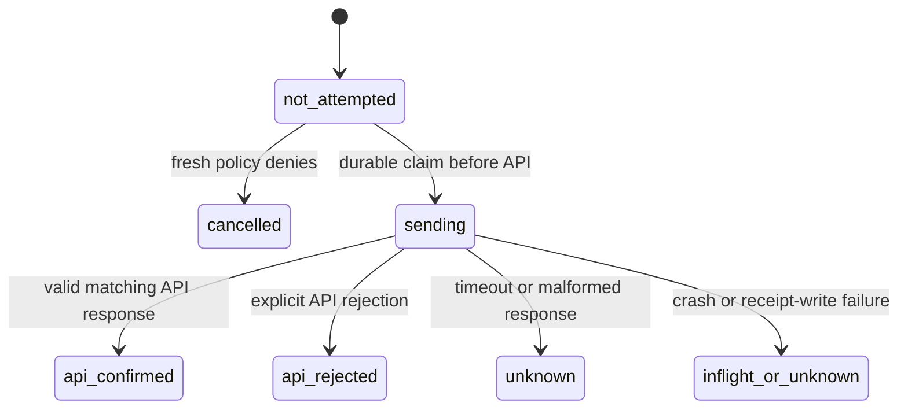

# Telegram report transport — локальный кандидат

`telegram_http.py` и `report_dispatch.py` проверены только моками. Не использовать настоящие ресурсы/токены без отдельного разрешения. GAS-кандидат и действующий bot transport не менялись.

## Подтверждение и доставка

`prepared` относится к локальному тексту до попытки. `api_confirmed` доказывает только корректный ответ API с message id/нужным chat/bot, не чтение или доставку адресату. `delivered` остаётся `None`. Неизвестные/отклонённые/отменённые исходы не повторяются автоматически. После нового явного запроса пользователя будет другой update; ручной replay старой неопределённой попытки требует отдельного процесса сверки, который здесь не реализован.

## Инварианты

- По умолчанию network/writes/dispatch выключены. Config flag не является разрешением пользователя.
- В SQLite хранится namespace/bot, update/attempt identity, phase, hash payload и API message/error code. Текст/токен/полные API responses в ledger не сохраняются. Хеш не является гарантией анонимности.
- Claim durable до вызова API; параллельный обработчик того же update не отправляет второе сообщение. SQLite private0700/0600, WAL/FULL; это не encryption/anti-rollback защита.
- `prepare_fresh` — trusted local reauthorization из canonical inbox record, не кеш старого PreparedReply. Оно выполняется до claim commit; send adapter вызывается уже вне DB transaction. Между policy check и API нет распределённой транзакции — future runtime должен минимизировать задержку и не откладывать готовый private payload в незащищённую очередь.
- `sendMessage` payload сохраняет plain-text/disabled previews и callback-only keyboard. Callback acknowledgement, edit/delete, рассылки и дополнительные side effects не входят в этот ledger. Если они появятся, нужны отдельные operation keys/состояния, а не повторное использование одного update key.
- Client проверяет configured bot через getMe перед polling/send; только fixed HTTPS origin/no redirects/POST JSON, timeout20s, response≤1MiB, без retry. Default TLS/proxy не отключать.
- Bot API credential находится внутри URL: не логировать request/exception internals, traces, response bodies или instance attributes. Публичные ошибки очищены от URL/токенов. В тестах только короткая искусственная строка.

## Входящая очередь и подтверждение

`telegram_inbox.py` сохраняет verified update batch и новый offset одной SQLite транзакцией. `poll_once` отправляет серверу только offset, прочитанный из уже committed state. Если приём/сохранение оборвались, курсор не угадывается и не поднимается по несохранённым данным. CAS не позволяет старому concurrent fetch перезаписать новый cursor; client/inbox bot identity должны совпасть до network call.

`pending` хранится отдельно от `handled/ignored/blocked`; подтверждение Telegram означает только «надёжно сохранено локально», не «обработано»/«доставлено». Неизвестные типы сохраняются для другого handler, не отбрасываются reports-only parser. Raw payload содержит приватные пользовательские данные, хранится только в private SQLite, проверяется hash, не выводится в лог/репозиторий. Операторская обработка blocked/unknown и retention policy ещё не реализованы.

Нельзя запускать второй независимый polling cursor рядом с рабочим ботом/GAS. Серверная retention, idle ID reset, failover/backup/rollback требуют отдельной проверки. Низкий новый ID не трактуется автоматически как reset. Inbox не восстанавливает уже истёкшие/подтверждённые другим consumer updates и не делает actual rollout безопасным сама по себе.

Реальные HTTP source/sends, test bot integration, webhook/poll worker, answerCallbackQuery и эксплуатационная сверка unknown не запускались. Semantic grading и запись оценок также не реализованы.

Локальная проверка: `bash tools/check-local.sh`. 364 Python-теста, включая13 ledger/10 HTTP/8 integration/10 inbox/10 worker; Node101 также проверяется скриптом. Все transport calls в этих tests инъецируются как mocks; никаких настоящих Bot API credentials/configuration не требуется.

## Reports-only worker

`ReportWorker.step()` default-disabled, без loop/scheduler. Он сверяет inbox/ledger project+bot, читает hash-checked persisted updates, reauthorizes before first send, а для существующего receipt только восстанавливает queue status. Ошибка mark после API success не создаёт новый send. Unknown/rejected/inflight блокируются для сверки. Неподдержанные updates остаются pending/deferred: это предотвращает потерю чужих функций, но требует общего dispatcher, иначе первые100 неподдержанных updates могут задержать reports. Такой worker не является полным production runtime. Нельзя автоматически очищать backlog ради обхода этой ситуации.
